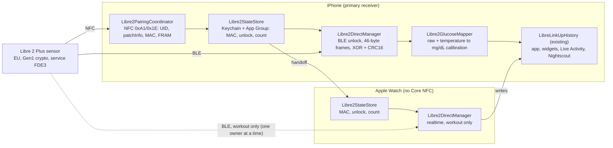

# FLwatch: Direct Libre 2 Plus over Bluetooth — Analysis

As of 2026-11-21.

## Summary

**EU Libre 2 Plus sensors can stream directly to the iPhone with no internet, using public MIT-licensed code. That makes a `libre2BLE` provider in FLwatch feasible.** US and other "Gen2" Libre 2 Plus sensors aren't feasible today.

- **Goal.** Libre 2 Plus readings on the iPhone and Apple Watch over Bluetooth, without LibreLinkUp.
- **Today.** FLwatch reads Libre 2 Plus only through the LibreLinkUp cloud. Its Libre 3 direct-BLE path (NFC pairing, the BLE manager, the shared history store and the watch workout handoff) is a ready-made template.
- **Protocol.** One NFC "enable streaming" scan on the iPhone. After that, BLE on service `FDE3`: a 12-byte unlock write, then a 46-byte XOR-encrypted frame every minute. FLwatch has to calibrate the raw values itself.
- **Recommended path.** Port LoopKit LibreTransmitter's MIT Libre 2 code into a new shared module. Model the provider on `libre3BLE`. Keep the iPhone as the primary receiver, and let the watch borrow the sensor only during workouts.
- **Main costs.** The official app loses its Bluetooth link and its alarms. Calibration accuracy has to be checked against the official app. watchOS keeps Bluetooth alive in the background only during workouts.
- **First step.** The sensor is sold in Europe, so it should be Gen1. Confirm with an NFC read of `patchInfo` (`C6` or `7F … 31`). Connecting it to xDrip4iOS is a quick way to check this (see [Appendix](#appendix-connecting-the-sensor-to-xdrip4ios)).

## How FLwatch talks to Libre today

FLwatch reads Libre data in two ways. The LibreLinkUp path follows the cloud. The Libre 3 path reads the sensor directly over Bluetooth. Both paths write into the same history store, so the home screen, watch, widgets, Live Activity and Nightscout read the data the same way whichever path produced it.

| Path | Provider kind | How readings arrive | Internet needed | Key files |
| --- | --- | --- | --- | --- |
| Cloud follow | `libreLinkUp` | The official Libre app uploads to LibreView. FLwatch polls LibreLinkUp about once a minute. | Always: on the phone that runs the Libre app and on the phone running FLwatch | `LibreLinkUp.swift`, `LibreLinkUpService.swift`, `LibreLinkUpHistory.swift` |
| BLE heartbeat (optional add-on to cloud follow) | `libreLinkUp` | FLwatch watches the sensor's Bluetooth activity, connecting without logging in, and treats each connect as a cue to poll the cloud 3 s later. No glucose comes over Bluetooth. | Yes | `BluetoothHeartbeatManager.swift`, `HeartbeatConnectionProfile.swift` |
| Libre 3 direct | `libre3BLE` | NFC pairing once, then an authenticated BLE session. The sensor pushes an AES-CCM-encrypted reading every minute, which is decoded on-device. Backfill is requested on reconnect. | Only for the one-time receiver-ID sign-in at pairing | `Libre3BLE/*`, `PhoneAppLibre3ConnectView.swift`, local package **RoundWhiteDiscKit** |

How the Libre 3 direct path works, step by step:

1. **Pairing (phone only, CoreNFC).** `Libre3PairingCoordinator` maps the user's `Libre3Mode` to a RoundWhiteDiscKit NFC scan. *Takeover* (`0xA8`, the default) rotates the BLE PIN, so FLwatch becomes the sole receiver. *Parallel join* (`0xA0`) is developer-only and now breaks because the vendor app re-scans. *Activate fresh* starts a new sensor and can't be undone. The PIN and the authorisation key are stored in the Keychain (`Libre3PINStore`). Metadata goes to the App Group (`Libre3StateStore`).
2. **Streaming.** `Libre3DirectManager` (`@MainActor`, about 7,000 lines) owns RoundWhiteDiscKit's scanner, session and decoder. It runs a full handshake once and a cached reconnect handshake after that. Each per-minute notification is decoded and passed through `Libre3GlucoseMapper` into `LibreLinkUpHistory`.
3. **Backfill.** `Libre3BackfillImporter` requests historical pages on connect, to fill gaps and seed the 6-hour graph.
4. **Watch handoff.** `WatchConnectivityManager` sends the watch a provisioning package (the reconnect key only, never the PIN). It can lend the sensor to the watch during a workout (`claimLibre3SensorForWorkout`) and take it back afterwards. `Libre3HostProfile` keeps the watch host realtime-only, with no backfill and no alerts.
5. **Background.** The iPhone uses the `bluetooth-central` background mode. The watch only has `workout-processing`, so direct BLE on the watch is tied to an active workout session.

The Libre 3 path is the template for a Libre 2 Plus provider. The provider protocol, the store, the mapper pattern, Nightscout eligibility (`isDirectBLE`), Keychain storage and the watch handoff can all be reused. What's specific to the sensor family is the NFC commands, the BLE handshake, the crypto and the decoding.

## Where Libre 2 Plus fits today

Today a Libre 2 Plus user can only use FLwatch through the cloud. No code reads a Libre 2 family sensor over Bluetooth.

- **Sensor types.** `SensorType.swift` has `libre2`, `libre2US`, `libre2CA`, `libre2RU` and `libre2Plus`, but they're only used as labels.
- **Cloud mapping.** `LibreLinkUp.getPatientGraph()` maps the device type `dtid` to a family. 40067 is Libre 2, 40068 is Libre 3 and 40066 is Libre 1, or Libre 2 when alarms are on. Nothing produces `libre2Plus`, so a 2 Plus sensor shows up as `libre2` or `unknown`.
- **Heartbeat.** `BluetoothHeartbeatManager` matches sensors whose advertised name contains `ABBOTT`. A Libre 2 Plus can trigger cloud polls this way, but no glucose comes over Bluetooth.
- **NFC.** The app already has the CoreNFC `TAG` entitlement and a usage string. Only the Libre 3 pairing code uses it.
- **RoundWhiteDiscKit** is Libre 3–specific ("FreeStyle Libre 3 / 3+ interoperability toolkit"). It can't decode Libre 2 Plus.

The gaps for offline Libre 2 Plus are:

1. NFC commands to enable streaming and get the unlock material.
2. A BLE connect and unlock for this family.
3. Per-packet decryption.
4. Turning raw readings into mg/dL.
5. A new `CGMProviderKind`, plus UI to connect a sensor.

## Libre 2 Plus protocol

EU Libre 2 Plus sensors use the original "Gen1" Libre 2 crypto. Public MIT-licensed Swift code already decrypts it on an iPhone. US Libre 2 Plus sensors use "Gen2" security, and the only public implementation is GPL C code from November 2026 that nobody has confirmed working. **The region of the sensor decides whether this is a few weeks of work or a research project.**

### Sensor families

The family is identified from `patchInfo`, which the NFC scan returns ([xDrip4iOS](https://github.com/JohanDegraeve/xdripswift), [DiaBLE](https://github.com/gui-dos/DiaBLE), [Juggluco](https://github.com/j-kaltes/Juggluco) `patch_profile.hpp`). Within family 3, a low nibble of `patchInfo[2]` below 9 means Gen1 and 9 or above means Gen2.

| `patchInfo` | Sensor | Security | Open iOS support |
| --- | --- | --- | --- |
| `C6 …` (2024) | EU Libre 2 Plus | Gen1 | Yes |
| `7F 0E 31 01` (2025) | EU Libre 2 Plus, newer batch, advertises its MAC as the name | Gen1 | Yes; xDrip4iOS fixed detection in [PR #720](https://github.com/JohanDegraeve/xdripswift/pull/720), May 2026 |
| `7F 0E 30 01` | EU Libre 2 (non-Plus), newer batch | Gen1 | Yes |
| `9D`, `C5` | EU Libre 2 | Gen1 | Yes |
| `2C 0A 3A 02` | US Libre 2 Plus | Gen2 | No (only Juggluco on Android, unverified) |
| `76`, `2B` | US/CA Libre 2, Libre Sense, RU/LatAm | Gen2 | No |

### Streaming flow (Gen1)

1. **NFC enable (iPhone, once per sensor).** Read `patchInfo` with `NFCISO15693Tag.customCommand` `0xA1`. Then send subcommand `0x1E` with a 4-byte unlock code and 4 bytes derived from the UID, `patchInfo` and the code. The sensor replies with its 6-byte BLE MAC. The same scan reads the UID and the FRAM calibration block. Subcommand `0x1B` would activate a new sensor instead.
2. **BLE connect.** Service `FDE3`, write characteristic `F001`, notify characteristic `F002`. The advertised name is `ABBOTT<serial>`, or the MAC on `7F` sensors. Subscribe, then write a 12-byte unlock payload: the code plus an `unlockCount` that goes up on every connect and resets at each NFC enable, plus 8 derived bytes.
3. **Per-minute frame.** 46 bytes arrive split across about 3 notifications. Decryption is an XOR keystream built from the UID and the first 2 bytes of the frame, then a CRC16 check over 42 bytes. Bytes 40–41 carry wear minutes.
4. **Frame contents.** 7 trend points (now and −2, −4, −6, −7, −12, −15 min) plus 3 history points 15 minutes apart. Each point has a 14-bit raw value, a 12-bit temperature and a temperature adjustment.
5. **Raw → mg/dL.** Decrypt the FRAM, derive the factory calibration, then apply a temperature algorithm. xDrip4iOS and DiaBLE each have one. [LibreTransmitter](https://github.com/LoopKit/LibreTransmitter) leaves its `GetGlucoseFromRaw.swift` out of the repo. No open version claims to match the official app exactly.

### Compared with what FLwatch does for Libre 3

| | Libre 3 (already in FLwatch) | EU Libre 2 Plus |
| --- | --- | --- |
| NFC step | Takeover `0xA8`, PIN rotation | Enable streaming `0xA1/0x1E`, returns MAC |
| Internet at pairing | Receiver-ID sign-in to LibreView, or a manual hex override | None |
| BLE auth | ECDH-style handshake, then a cached reconnect key | 12-byte unlock write on each connect |
| Payload crypto | AES-CCM | XOR keystream + CRC16 |
| Values | Calibrated mg/dL from the sensor | Raw values; the app has to calibrate |
| History on reconnect | Backfill command | Only the last 15 min trend + 45 min history in each frame |

The EU Libre 2 Plus is the simpler sensor in every row except calibration, which FLwatch would have to own.

### Prior art

| Project | EU 2 Plus direct on iOS | Gen2 | Licence | Reusable in MIT FLwatch? |
| --- | --- | --- | --- | --- |
| [LoopKit LibreTransmitter](https://github.com/LoopKit/LibreTransmitter) (+ [loopandlearn fork](https://github.com/loopandlearn/LibreTransmitter) used by Trio) | Yes (`C5/9D/C6/7F`) | No | MIT | Yes — best base; calibration file not included |
| [DiaBLE](https://github.com/gui-dos/DiaBLE) (archived Jul 2026) | Prototype | Empty class | MIT | Yes, but its README says parts were copied from other repos, so origin is unclear |
| [xDrip4iOS](https://github.com/JohanDegraeve/xdripswift) | Yes, production | No | GPL-3.0 | Reference only |
| [Juggluco](https://github.com/j-kaltes/Juggluco) | Android/Wear OS only | Added 2026-11-15, unverified | GPL-3.0 | Reference only |
| [RoundWhiteDiscKit](https://github.com/poml88/RoundWhiteDiscKit) | No (Libre 3/3+ only) | – | MIT | Already used for Libre 3 |

## Proposed design

Add a fourth provider, `libre2BLE`, as a smaller sibling of `libre3BLE`. Everything after the decoder is shared with the existing code. No RoundWhiteDiscKit changes are needed; the Libre 2 code would live in a new MIT module ported from LibreTransmitter.

The iPhone does the NFC enable and normally holds the sensor. The watch gets the unlock material through the existing provisioning handoff, and connects only while it has claimed the sensor for a workout.

Changes by area:

| Area | Change | Reuses |
| --- | --- | --- |
| `CGMProvider.swift` | Add `case libre2BLE` with `isDirectBLE = true` and a 1-minute cadence; add `CGMReadingSource.libre2BLE` to the Nightscout direct-source set | Provider switch, Nightscout eligibility |
| New `Libre2BLE/` module (shared) | `PreLibre2` crypto, frame assembler, unlock payload and calibration, ported from LibreTransmitter (MIT) with the source noted | – |
| `Libre2PairingCoordinator` (iOS) | CoreNFC: read `patchInfo`, refuse Gen2, send enable streaming, read FRAM calibration | `NFCReaderUsageDescription` and `TAG` entitlement already present |
| `Libre2StateStore` | Unlock code in the Keychain; MAC, serial, `patchInfo`, `unlockCount` and calibration in the App Group | `Libre3PINStore` / `Libre3StateStore` patterns |
| `Libre2DirectManager` (`@MainActor`) | Scan for `FDE3` / `ABBOTT*`, connect, write unlock, assemble and decrypt frames, reconnect watchdog | `Libre3DirectManager` reconnect patterns, `bluetooth-central` background mode |
| `Libre2GlucoseMapper` | Trend and history points to `LibreLinkUpGlucose`, de-duplicated by sensor minute | `Libre3GlucoseMapper` |
| UI | `PhoneAppLibre2ConnectView`, entry in the provider picker, takeover warning | `PhoneAppLibre3ConnectView` |
| Watch | Add Libre 2 fields to the provisioning package and generalise the claim/release workout handoff (bump `currentProtocolVersion`) | `WatchConnectivityManager` |
| Tests | Recorded encrypted frames to expected mg/dL; Gen1/Gen2 `patchInfo` classification; backward-compatible snapshots | `LibreWristTests` |

The heartbeat (`BluetoothHeartbeatManager`) should be off in `libre2BLE` mode, as it is for Libre 3, because FLwatch then owns the link.

## Risks and constraints

The biggest risks are the region (Gen2 blocks everything) and the Apple Watch's background Bluetooth limits. The rest can be managed with clear wording in the UI.

| Risk | Impact | Mitigation |
| --- | --- | --- |
| Sensor is Gen2 (US/CA/LatAm/RU Libre 2 Plus) | Can't decrypt with any MIT code | Detect `patchInfo` at the NFC scan and refuse with a clear message. Gen2 stays a separate research item. |
| Only one app can own the sensor's Bluetooth link | Enabling streaming takes over BLE; the official app loses its link and its alarms, and [xDrip4iOS](https://xdrip4ios.readthedocs.io/en/latest/connect/libre2/) says the Libre app's Bluetooth permission must be off | Same "takeover" warning as Libre 3 takeover. FLwatch's own low/high alerts (`LowGlucoseNotificationManager`) become the only alarms. |
| Calibration accuracy | Raw-to-mg/dL is FLwatch's job; no open algorithm claims parity with Abbott | Port LibreTransmitter's or DiaBLE's (MIT) algorithm, compare it with the official app on the same sensor for a few days, and show a "not a medical device" disclaimer. |
| Abbott keeps changing patch bytes and naming (`C5` 2023, `C6` 2024, `7F` 2025) | New batches aren't detected or are detected as the wrong family | Table-driven detection with a clear "unsupported patchInfo: XX" error and diagnostics logging. |
| Short history in each frame (about 45 min) | Gaps longer than that can't be refilled over BLE | Optionally re-read the FRAM history (8 h) with NFC, or accept the gaps. |
| Apple Watch has no Core NFC | NFC enable must run on the iPhone | The iPhone sends the watch the UID, `patchInfo`, unlock code, MAC and `unlockCount`, through the existing provisioning-package path. |
| Apple Watch background BLE | Without Apple's restricted `bluetooth-central-background` entitlement ([forum](https://developer.apple.com/forums/thread/109947)), the link lives only while the app runs or a workout is active; a [2026 report](https://developer.apple.com/forums/thread/844843) saw drops about 3 min after backgrounding even during a workout | Keep the iPhone as the primary receiver. The watch takes over only in workout mode, as it already does for Libre 3. |
| `unlockCount` drift if the phone and watch both connect | Unlock fails until the next NFC enable | Only one device holds the sensor at a time (the Libre 3 claim/release model), and the count goes back with the handback. |
| Legal and Abbott terms of service | Not checked | Personal-use fork; get a legal opinion before distributing. The US FDA recall (Nov 2025) covered Libre 3/3+ only, not Libre 2 Plus ([FDA](https://www.fda.gov/medical-devices/medical-device-recalls-and-early-alerts/glucose-monitor-sensor-recall-abbott-diabetes-care-removes-certain-freestyle-libre-3-and-freestyle)). |
| Licence contamination | xDrip4iOS and Juggluco are GPL-3.0 | Use them for reading only. Port from MIT sources and note where each piece came from. |

## Next steps and open questions

The first step is to find out which sensor we have. Everything after that depends on it being Gen1.

- [ ] Region confirmed as EU (likely Gen1). Confirm `patchInfo` with an NFC read: `C6` or `7F … 31` is a go, `2C` is Gen2. Getting readings in xDrip4iOS as "Libre 2/2+ EU" is strong evidence of Gen1.
- [x] Establish a simulator baseline with FLwatch 3.1.7 build 242. See [Simulator baseline](#simulator-baseline) for the dependency revisions and test result.
- [x] Decode Gen1 frames in the existing `LibreWristTests` target using an upstream encrypted fixture and a derived follow-up frame.
- [ ] Spike: NFC enable + BLE unlock on a real sensor, logging decrypted raw values next to the official app's readings.
- [ ] Choose and validate the calibration algorithm (LibreTransmitter vs DiaBLE) by comparing it with the official app for at least 2 days.
- [ ] Build the `libre2BLE` provider, connect view and tests (see Proposed design).
- [ ] Watch: extend the provisioning package and workout claim/release to Libre 2 Plus.

Open questions:

- Region: resolved. The sensor is sold in Europe, so it should be Gen1; an NFC read of `patchInfo` still confirms it.
- Should FLwatch also be able to activate a new sensor (`0x1B`), or only take over one the official app started? Taking over only is the recommendation, matching the default for Libre 3.
- Is losing the official app's alarms acceptable, or is a passive "listen only" mode needed? Listen-only skips the unlock write, works only on the same iPhone, and has no watch support.
- Should Gen2 (US Libre 2 Plus) be in scope? It would mean porting GPL Juggluco code or doing independent reverse engineering, and it isn't recommended.

## Implementation plan for `libre-2-nfc`

The goal is direct Bluetooth glucose readings from a supported European Libre 2 Plus sensor on iPhone and Apple Watch, with the internet disconnected. The iPhone scans the sensor over NFC and normally receives readings. During a workout, the watch can claim the sensor and receive readings directly with the phone out of range. EU Gen1 compatibility is the working assumption until a physical scan confirms the sensor variant.

### 1. Prove frame decoding in the simulator

- Review the license and provenance of the LibreTransmitter code and any fixtures before incorporating them. Use the verified simulator setup below.
- Add a shared Libre 2 module that classifies NFC patch info, assembles fragmented BLE notifications, decrypts Gen1 frames, checks their integrity and extracts raw glucose, temperature and wear time. Keep these operations independent of Core Bluetooth and Core NFC.
- Add fixture tests to `LibreWristTests` for supported Libre 2 Plus signatures, unsupported variants, corrupt or incomplete frames, and trend/history timestamps. Use known expected output for a captured frame and exercise duplicate delivery and reconnect overlap.

**Complete.** Commit `a7052a6` compiled the decoder for iOS and watchOS. All 187 unit tests passed on the iPhone 17 simulator with iOS 27.2, including the five new Libre 2 tests.

The decoder uses the `Libre2.BLEExample` fixture from [LibreTransmitter at `41105123`](https://github.com/LoopKit/LibreTransmitter/blob/41105123c3c4fb5c55ce89a38630cea2f8f7a17a/LibreSensor/SensorContents/PreLibre2.swift). Expected values were checked with the upstream decoder. The fixture exercises Gen1 framing and raw values. The source does not identify its exact sensor variant. The follow-up frame is synthetic and tests that overlapping samples retain their sensor-minute identity. Cross-frame deduplication belongs at ingestion in step 3.

### 2. Verify NFC and BLE on a physical iPhone

**Started.** In a signed iPhone build, enable Developer Mode in FLwatch and open **Settings → Debug Info → Read Libre 2 Plus sensor information**. Hold the top of the iPhone against the sensor. The scanner reads the patch bytes and reports whether they match the current EU Plus allowlist. It issues the empty ISO 15693 patch-info request and displays the result only in memory. Record the patch bytes and recognition result before attempting a separate streaming test. Physical verification remains pending.

The diagnostic compiled and all 187 unit tests passed on the iPhone 18 Pro Max simulator with iOS 27.2.

- Sign FLwatch with a team that supports NFC Tag Reading. Use a spare, already-started sensor so the takeover does not interrupt an active monitoring setup.
- Add a connection flow that reads patch info first. Proceed with enabling streaming only for supported variants and after the user confirms the effect on the Abbott app connection. Read and retain the calibration data and reconnect state. Keep unlock material in Keychain and out of diagnostics.
- Confirm that the iPhone receives fresh frames with internet access disabled. Exercise backgrounding and reconnect. If the sensor variant is unsupported or the scan fails, surface the error before attempting streaming.

### 3. Validate glucose conversion and integrate the iPhone provider

- Establish the source and license for the calibration implementation. Validate its output against timestamped Abbott reference readings and document the comparison before exposing experimental readings through normal app surfaces.
- Register `libre2BLE` in `CGMProviderKind` and `CGMReadingSource`. Route validated readings through `LibreLinkUpHistory` so existing displays can use them. Order and deduplicate by sensor identity and sensor minute, including overlapping trend/history data after reconnect.
- Cover provider switching, persisted snapshot compatibility and direct-source Nightscout eligibility in unit tests. Verify that LibreLinkUp and Libre 3 still work and that the direct provider runs with LibreLinkUp credentials absent.

### 4. Add and verify Apple Watch workout handoff

- Extend `WatchConnectivityManager` provisioning with the Libre 2 reconnect data. Version the message, keep existing Libre 3 peers compatible, and require compatible peers for a Libre 2 handoff.
- Persist and transfer the latest unlock counter with ownership. Test acknowledgment, timeout, interruption, watch restart and return to the phone. Verify that only the current owner connects and that syncing readings after handback does not duplicate or shift them.
- On physical hardware, start a workout, take the phone out of Bluetooth range and verify that current glucose continues on the watch with its display asleep. End the workout and verify that the phone resumes receiving readings. Record observed limits on background reception and reconnects.

The first implementation milestone is a passing Gen1 frame fixture test. The first hardware milestone is a verified Libre 2 Plus stream on iPhone with internet access disabled. Watch workout handoff completes the initial scope. New sensor activation, Gen2 support and all-day standalone watch streaming are deferred.

## Simulator baseline

Run `bash scripts/setup_roundwhitedisckit.sh` from the FLwatch checkout to reproduce the local package setup.

On 2026-11-21, FLwatch 3.1.7 build 242 (`9f7e722`) built successfully with Xcode 27.2. All 182 `LibreWristTests` passed on the iPhone 18 Pro simulator running iOS 27.2 (runtime build `24B8117`). This run covered the simulator build and unit tests. NFC pairing and sensor streaming still require a physical iPhone.

FLwatch resolves RoundWhiteDiscKit from `~/GitHub/RoundWhiteDiscKit`. [Phil’s reply on issue #31](https://github.com/poml88/FLwatch/issues/31#issuecomment-7002780837) pointed to [the original package](https://github.com/airedev326/RoundWhiteDiscKit), whose commit `7dd6396` provides `AppIdentities.install(json:)`. The build used that commit with four commits from [Phil’s `watchos-support` branch](https://github.com/poml88/RoundWhiteDiscKit/tree/watchos-support) cherry-picked in order: `28cc246`, `fe2653d`, `a019d6a`, and `aabc070`. The resulting local package branch is `flwatch-242` at `d1cba08`.

## Appendix: Connecting the sensor to xDrip4iOS

xDrip4iOS reads EU Libre 2 Plus sensors directly over Bluetooth today. Connecting the current sensor to it is a quick, real-world check that the sensor is Gen1 before any FLwatch code is written. Everything below comes from the xDrip4iOS docs as of 2026-11-21, except where marked.

### Installing xDrip4iOS

xDrip4iOS is not on the App Store and has no public TestFlight; you build it yourself ([install docs](https://xdrip4ios.readthedocs.io/en/latest/install/install/)). It needs iOS 16.2 or later. The Apple Watch app (Series 4 or newer, watchOS 10 or later) is built along with it.

**Option 1: Xcode on a Mac** ([build docs](https://xdrip4ios.readthedocs.io/en/latest/install/build/)). The project is set up for Xcode 26.

1. `git clone https://github.com/JohanDegraeve/xdripswift.git`
2. Open **`xdrip.xcworkspace`** (not the `.xcodeproj`).
3. Create `xDripConfigOverride.xcconfig` with your own unique bundle ID and App Group.
4. In Xcode, go to **Settings → Accounts** and add your Apple ID.
5. Select each target and set **Team** to your account. Fix any signing errors.
6. Connect the iPhone, trust the Mac, and enable Developer Mode on the phone if asked.
7. Select the iPhone as the run destination, then **Build and Run**.

A free Apple ID works, but signing lasts only a limited period. The docs don't give the length; it is usually 7 days with a free account (not from the docs). A paid Apple Developer membership gives longer-lived signing.

**Option 2: browser build with GitHub Actions** ([browser build docs](https://xdrip4ios.readthedocs.io/en/latest/install/browserBuild/)). Needs a paid Apple Developer membership and a GitHub account; about 2 hours to set up.

1. Fork `JohanDegraeve/xdripswift`.
2. Add six repository secrets: `TEAMID`, `FASTLANE_ISSUER_ID`, `FASTLANE_KEY_ID`, `FASTLANE_KEY`, `GH_PAT`, `MATCH_PASSWORD`.
3. Create the App Groups, identifiers and the App Store Connect app, as the docs describe.
4. In the fork's Actions tab, run in order: **1. Validate Secrets**, **2. Add Identifiers**, **3. Create Certificates**, **4. Build xDrip4iOS**.
5. Install from the TestFlight app. Builds expire after 90 days; the fork rebuilds monthly.

### Connecting an already-running Libre 2 Plus

From the [Libre 2 connect page](https://xdrip4ios.readthedocs.io/en/latest/connect/libre2/): "You can connect xDrip4iOS to a supported Libre sensor that has already been started." The NFC scan reads the sensor's existing start time, so there is no restart or new warm-up.

Before you start:

- The official Libre app will probably lose its Bluetooth link and alarms, and LibreView uploads will probably stop. The xDrip4iOS docs don't say this; other projects (DiaBLE, Juggluco) do. Keep a fingerstick meter handy.
- If you use CamAPS with this sensor, don't do this. The docs say xDrip4iOS can't share the sensor with it.

Steps:

1. Turn Bluetooth on.
2. In iPhone **Settings**, find the Libre app and turn off its **Bluetooth** permission. Otherwise the Libre app "can take over the sensor connection and stop xDrip4iOS from receiving readings."
3. In xDrip4iOS, go to **Settings → General** and choose your glucose unit.
4. Go to **Settings → Data Source** and select **Master**.
5. Allow Bluetooth when iOS asks. Don't pair the sensor from iOS's Bluetooth settings.
6. Go to the **Devices** tab, tap **add**, choose **CGM**, then **Libre 2/2+ EU**, then **NFC scan**.
7. Hold the top of the iPhone against the sensor and keep still until the app confirms. If it fails, move slowly and tap **Scan Again**.
8. Tap **Connect** and wait for the first reading (can take a couple of minutes).
9. On the Home screen, check the value looks right, the time is current, and there's no error at the bottom. Compare it with a fingerstick reading.

Afterwards:

- Only rescan when xDrip4iOS shows **NFC scan needed**; rescanning doesn't fix a working Bluetooth link.
- **Devices** may show **Algorithm Type**: "Native Algorithm" needs no calibration; "xDrip Algorithm" requires it.
- **Sensor Management** (sensor button on the Home toolbar) shows the sensor family. The docs don't say whether the raw `patchInfo` bytes are shown.
- Switching back to the official app isn't covered by the docs. Turning its Bluetooth permission back on and scanning with the Libre app will probably take the sensor back, but this hasn't been verified.

## Sources

- [xDrip4iOS source](https://github.com/JohanDegraeve/xdripswift) and [PR #720](https://github.com/JohanDegraeve/xdripswift/pull/720)
- xDrip4iOS docs: [Libre 2 connect](https://xdrip4ios.readthedocs.io/en/latest/connect/libre2/), [install](https://xdrip4ios.readthedocs.io/en/latest/install/install/), [Xcode build](https://xdrip4ios.readthedocs.io/en/latest/install/build/), [browser build](https://xdrip4ios.readthedocs.io/en/latest/install/browserBuild/)
- [DiaBLE](https://github.com/gui-dos/DiaBLE)
- [LoopKit LibreTransmitter](https://github.com/LoopKit/LibreTransmitter) and the [loopandlearn fork](https://github.com/loopandlearn/LibreTransmitter)
- [Juggluco](https://github.com/j-kaltes/Juggluco)
- [RoundWhiteDiscKit](https://github.com/poml88/RoundWhiteDiscKit)
- Apple Developer Forums: [background BLE entitlement](https://developer.apple.com/forums/thread/109947), [BLE drops during workouts](https://developer.apple.com/forums/thread/844843)
- [FDA recall notice](https://www.fda.gov/medical-devices/medical-device-recalls-and-early-alerts/glucose-monitor-sensor-recall-abbott-diabetes-care-removes-certain-freestyle-libre-3-and-freestyle)
